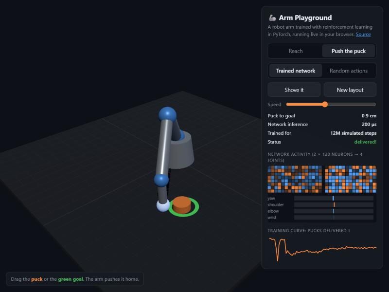

#  Arm Playground

**A robot arm trained with reinforcement learning in PyTorch, running live in your browser.**
Drag the target and it chases it. Put a puck and a goal on the table and it pushes the puck home.
Shove it mid-motion and it recovers. No install, no server, no ML library in the browser.

### ▶ [Try the live demo](https://zerochance1907.github.io/arm-playground/)



[](https://github.com/zerochance1907/arm-playground/actions/workflows/ci.yml)
[](LICENSE)


## What you're looking at

A 4-joint arm (base yaw, shoulder, elbow, wrist) with velocity-controlled motors,
actuator lag and joint limits. Every 20 ms a small neural network (2 × 128 neurons)
reads the arm's state and outputs four motor commands. At run time nothing is
scripted: there is no inverse kinematics and no path planner in the browser, just the
network.

| Task | What the network learned | How it was trained | Result (2000 fresh random layouts) |
|---|---|---|---|
| **Reach** | Move the hand to a 3D target, and re-chase it when you drag it | PPO from scratch, 20M simulated steps | **94%** within 3 cm · median **0.68 s** · median error **1.1 cm** |
| **Push** | Get behind a puck and shove it onto a goal spot, without overshooting | Imitation of a scripted pusher (DAgger, 1.8M steps), then PPO refinement (10M steps) | **99.5%** delivered · **97.5%** still on goal at the end · median **1.1 s** |

The Push network ends up better than the scripted controller it started from: that
controller delivers 95% of pucks, and imitation alone reached 96.7% in 1.84 s. PPO
then pushed it to 99.5% and made it about 40% faster.

The panel on the right shows the network thinking: all 256 hidden neurons light up
live (orange = positive, blue = negative), next to the four motor commands they
produce. Switch to **Random actions** to see what the arm does without its brain.

## How it works

```
 arm/sim.py  ──── PyTorch, batched ────►  arm/train.py (PPO, 1024 arms in parallel)
     │                                          │
     │ line-for-line port                       ▼
     ▼                                   arm/export.py ──► web/policies/*.json (weights)
 web/sim.js  ◄── tests/parity.test.mjs ──►      │
     │        (same trajectory to 1e-6)         ▼
     └──────────────► web/policy.js: plain-JS forward pass ──► three.js scene
```

1. **One simulator, two languages.** [`arm/sim.py`](arm/sim.py) is the physics (arm
   kinematics, motor lag, joint limits, a puck with friction, contact with the hand,
   base and walls), written as batched PyTorch ops so 1024 arms step at once.
   [`web/sim.js`](web/sim.js) is a line-for-line port.
2. **Training.** [`arm/train.py`](arm/train.py) is a compact PPO implementation (no RL
   library) with observation normalization, GAE, and dense progress rewards. It runs
   on a laptop CPU at roughly 15–30k simulated steps per second. Push is first
   bootstrapped by imitation ([`arm/imitate.py`](arm/imitate.py)), then refined with
   the same PPO.
3. **Export.** [`arm/export.py`](arm/export.py) writes the actor network and its
   normalization statistics to plain JSON (~180 KB per task).
4. **Parity, enforced in CI.** The exporter also records a 200-step trajectory in
   float64 *from the exported JSON*. [`tests/parity.test.mjs`](tests/parity.test.mjs)
   replays it with the JavaScript sim and policy and fails if any joint, puck position
   or action drifts by more than 1e-6. What you see in the browser is exactly what was
   trained.
5. **Inference in the browser.** [`web/policy.js`](web/policy.js) is 30 lines: a
   normalize, three matrix multiplies and two `tanh`s. It takes about 100 µs per step.

## Run it yourself

```bash
git clone https://github.com/zerochance1907/arm-playground && cd arm-playground
python -m venv .venv && . .venv/bin/activate        # Windows: .venv\Scripts\activate
pip install torch --index-url https://download.pytorch.org/whl/cpu

python -m arm.train reach --steps 20e6    # ~20 min on a laptop CPU
python -m arm.imitate                     # Push, step 1: imitate the scripted pusher (~1.5 min)
python -m arm.train push --init checkpoints/push.pt --steps 10e6 --lr 1e-4 --critic-warmup 20
python -m arm.export reach push           # writes web/policies/*.json + parity traces
python -m arm.evaluate                    # success rates on fresh random layouts
npm test                                  # JS sim + policy must match PyTorch

python -m http.server --directory web     # open http://localhost:8000
```

Want a new task? Add an env class to `arm/sim.py` (an observation, a reward, a reset),
port its observation to `web/sim.js`, train, export. The parity test tells you if the
port is wrong.

## Design notes

- **Velocity control with lag**, not teleporting joints: the network has to plan for
  momentum, which is why shoving the arm is a real test.
- **Progress rewards.** Rewarding only "be close" gave PPO a signal too faint to learn
  from (a single step moves the hand a few millimetres). Adding "how much closer did
  that step get you" made Reach learn about 10× faster.
- **Moving targets during training**: targets jump to new spots at random, so the
  policy learned to re-chase, which is what makes dragging feel responsive.
- **Why Push needed a head start.** From scratch, PPO found a dead end: hovering
  near the puck scores better than bumping it the wrong way, so it never learned to
  push (about 16M steps across three reward designs, essentially zero deliveries). Pushing is a
  sequence: get behind the puck, get low, push, stop. So a ~60-line scripted
  controller ([`arm/expert.py`](arm/expert.py)) demonstrates it,
  [`arm/imitate.py`](arm/imitate.py) clones it with DAgger (the network also learns
  to recover from its own mistakes), and PPO refines it from there. The scripted
  controller is only used in training and never ships to the browser.
- **No ONNX, no TensorFlow.js.** For a 2-layer MLP, a hand-written forward pass is
  smaller, faster to load, and trivially auditable.

## License

[MIT](LICENSE)
