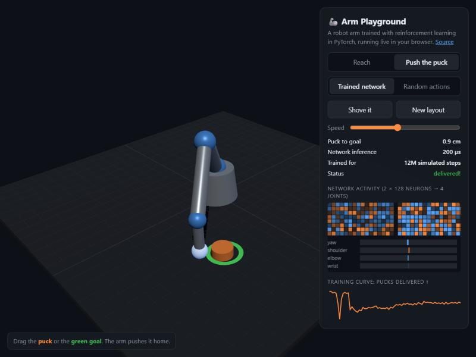

# Arm Playground: PPO policies for a 4-joint robot arm

Two small neural-network controllers for a simulated 4-joint robot arm (base yaw,
shoulder, elbow, wrist), trained with reinforcement learning in PyTorch:

- **`reach`** moves the hand to a 3D target and re-chases it when the target moves.
- **`push`** gets behind a puck and shoves it onto a goal spot on the table without overshooting.

Every 20 ms the policy reads the arm's state and outputs four joint velocity commands.
Nothing else is scripted: no inverse kinematics, no path planner.

**▶ [Live demo in the browser](https://zerochance1907.github.io/arm-playground/)** ·
**[Hugging Face Space](https://huggingface.co/spaces/{{HF_USER}}/arm-playground)** ·
**[Source code on GitHub](https://github.com/zerochance1907/arm-playground)**



## Files

| File | What it is |
|---|---|
| `reach.safetensors`, `push.safetensors` | PyTorch weights plus observation normalization buffers (`obs_mean`, `obs_std`) |
| `reach.onnx`, `push.onnx` | The same policies as ONNX (opset 17). Input `obs` `[batch, obs_dim]`, output `action` `[batch, 4]`, float32 |
| `config.json` | Per task: obs/action sizes, hidden sizes, activation, a name for every observation and action component, joint limits, velocity scales, 20 ms control period |

Both formats are **drop-in policies**: they take the raw observation and do the
normalization, the MLP and the output clipping themselves, exactly like the browser demo
(`clip((obs - mean) / std, -5, 5)` → Linear 128 → tanh → Linear 128 → tanh → Linear 4 →
`clip(-1, 1)`). They were rebuilt from the JSON weights the demo runs, and the export
script checks that PyTorch, ONNX Runtime and the demo's forward pass agree to within
1e-5 (in practice about 1e-6) on the repo's parity trajectories and on thousands of
random observations.

## Observation and action spaces

Joint angles `q = [yaw, shoulder, elbow, wrist]` (radians; pitch joints chained from
the horizontal), joint velocities `qd`, positions in metres with the arm base at the
origin, `z` up.

| Task | obs_dim | Observation (in order) |
|---|---|---|
| Reach | 21 | `sin(q)` (4), `cos(q)` (4), `qd / vmax` (4), hand xyz (3), target xyz (3), target − hand (3) |
| Push | 25 | `sin(q)` (4), `cos(q)` (4), `qd / vmax` (4), hand xyz (3), puck xy (2), puck velocity xy (2), goal xy (2), puck − hand xy (2), goal − puck (2) |

**Action** (both tasks): 4 numbers in `[-1, 1]`, one target velocity per joint, scaled
by `vmax = [2.0, 2.0, 2.5, 3.0]` rad/s. The motors follow the command through a
first-order lag (τ = 80 ms) and stop at hard joint limits. Control runs at 50 Hz.
`config.json` names every component.

## Training

All training ran on CPU with a compact PPO implementation (no RL library), with 1024
simulated arms in parallel, observation normalization, GAE and dense progress rewards.

| Task | How it was trained |
|---|---|
| Reach | PPO from scratch, 20M simulated steps. Targets jump to new spots during episodes so the policy learns to re-chase. |
| Push | Imitation of a scripted pusher (DAgger, 1.8M steps), then PPO refinement (10M steps). From scratch, PPO got stuck hovering near the puck; the scripted expert is only used in training. |

## Results

Evaluated on 2000 fresh random layouts in the training simulator:

| Task | Result |
|---|---|
| **Reach** | **94%** within 3 cm · median **0.68 s** · median error **1.1 cm** |
| **Push** | **99.5%** delivered · **97.5%** still on goal at the end · median **1.1 s** |

The Push policy ends up better than the scripted controller it imitated: that controller
delivers 95% of pucks, and imitation alone reached 96.7% in 1.84 s.

## Limitations

- **Custom simulator, not a real robot.** The physics (kinematics, motor lag, joint
  limits, a sliding puck with simple contact) is a small hand-written simulator
  ([`arm/sim.py`](https://github.com/zerochance1907/arm-playground/blob/main/arm/sim.py)).
  The policies have only ever seen that simulator.
- **No sim-to-real.** There is no domain randomization, no sensor noise model and no
  real-hardware testing. Do not drive a physical arm with these weights.
- The observation includes exact simulator state (hand, puck and goal positions), which a
  real system would have to estimate.
- Results are for the task distributions used in training (targets and pucks within the
  arm's reach on a 1.3 m table); behaviour outside them is untested.

## Usage

The policy only needs the observation vector. To roll it out you need the simulator from
the GitHub repo (`arm/sim.py` in PyTorch, or `web/sim.js` in JavaScript).

### ONNX Runtime

```python
# pip install onnxruntime numpy huggingface_hub
import numpy as np
import onnxruntime as ort
from huggingface_hub import hf_hub_download

path = hf_hub_download("{{HF_USER}}/arm-playground", "reach.onnx")
policy = ort.InferenceSession(path)

obs = np.zeros((1, 21), dtype=np.float32)     # raw observation, layout in config.json
action = policy.run(["action"], {"obs": obs})[0]
print(action)                                  # [[yaw, shoulder, elbow, wrist]] in [-1, 1]
```

### safetensors + PyTorch

```python
# pip install torch safetensors huggingface_hub
import torch
from huggingface_hub import hf_hub_download
from safetensors.torch import load_file


class ArmPolicy(torch.nn.Module):
    def __init__(self, obs_dim, hidden=(128, 128), action_dim=4):
        super().__init__()
        self.register_buffer("obs_mean", torch.zeros(obs_dim))
        self.register_buffer("obs_std", torch.ones(obs_dim))
        sizes = (obs_dim, *hidden, action_dim)
        self.layers = torch.nn.ModuleList(torch.nn.Linear(a, b) for a, b in zip(sizes[:-1], sizes[1:]))

    def forward(self, obs):
        x = ((obs - self.obs_mean) / self.obs_std).clamp(-5, 5)
        for i, layer in enumerate(self.layers):
            x = layer(x)
            if i < len(self.layers) - 1:
                x = torch.tanh(x)
        return x.clamp(-1, 1)


policy = ArmPolicy(obs_dim=25)                 # "push"; use 21 for "reach"
policy.load_state_dict(load_file(hf_hub_download("{{HF_USER}}/arm-playground", "push.safetensors")))
policy.eval()

with torch.no_grad():
    action = policy(torch.zeros(1, 25))        # raw observation, layout in config.json
```

To run a full episode, step the simulator from the repo with this action every 20 ms
(`arm.sim.arm_step`, and `arm.sim.puck_step` for Push).

## Citation

```bibtex
@software{arm_playground_2026,
  title  = {Arm Playground: a PyTorch-trained robot arm that runs live in the browser},
  author = {zerochance1907},
  year   = {2026},
  url    = {https://github.com/zerochance1907/arm-playground},
  license = {MIT}
}
```
